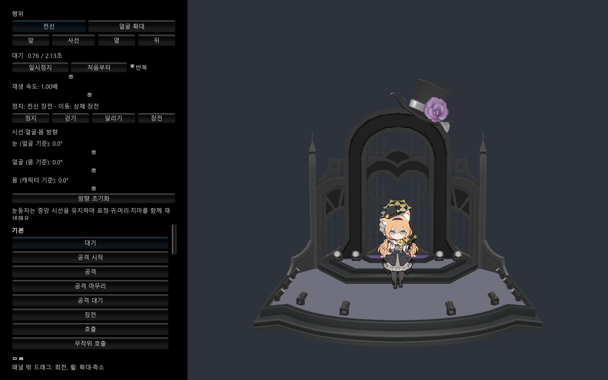

# MariPreview

블루 아카이브의 이오치 마리 아이돌 모델과 애니메이션을 확인하는 독립 Unity 애플리케이션입니다. 개인 학습과 취미 개발을 위한 비공식 팬 프로젝트입니다.



## 기능

- `IdolStage` 무대에서 마리 모델·표정·모션 표시
- 37개 애니메이션을 `기본`, `무릎`, `이동`, `점프·착지`, `카페`, `스킬`, `편성`, `승리`, `피격·퇴장`, `공용`의 10개 섹션으로 표시
- 행위 선택, 일시정지, 처음부터 재생, 재생 위치·속도 조절
- 반복을 끈 장전은 마지막 자세 유지, 반복을 켠 장전은 반복 재생
- 전신 장전과 이동 중 상체 장전, 눈·얼굴·몸 방향 조절
- 전신·얼굴 확대, 앞·사선·옆·뒤 시점, 드래그 회전과 휠 확대·축소
- 창 높이에 맞춰 늘어나는 행위 패널과 섹션별 스크롤 목록

## 개발 환경

| 구성 | 버전 |
|---|---|
| Unity Editor | 6000.5.4f1 |
| Universal Render Pipeline | 17.5.0 |
| 실행 파일 | Windows 64비트 |

대용량 FBX와 애니메이션은 Git LFS로 관리합니다. Git LFS가 설치된 환경에서 다음 순서로 준비합니다.

```powershell
git clone https://github.com/LeinneSW/MariPreview.git
cd MariPreview
git lfs install --local
git lfs pull
```

Unity Hub에서 프로젝트 폴더를 추가하고 [MariPreview 씬](Assets/MariPreview/Scenes/MariPreview.unity)을 열어 Play를 실행합니다.

## 조작과 빌드

| 조작 | 동작 |
|---|---|
| 행위 목록 | 해당 애니메이션 선택 |
| 숫자 1·2·3·4 | 대기·걷기·달리기·무릎 대기 |
| Space | 점프 |
| 패널 밖 드래그·휠 | 카메라 회전·확대·축소 |

Unity 메뉴 `Tools > 마리 프리뷰 > Windows 실행 파일 빌드`로 빌드합니다. 결과는 `Builds/Windows/MariPreview.exe`이며, 같은 폴더의 데이터와 DLL을 함께 사용합니다.

`Library`, `Temp`, `Logs`, `UserSettings`, `Builds`, `Review`와 IDE 생성 파일은 커밋 대상에서 제외합니다.

## 프로젝트 구성과 출처

- [프리뷰 씬·UI·카메라](Assets/MariPreview)
- [모션·시선·윤곽선 제어](Assets/Scripts)
- [캐릭터·무대 프리팹](Assets/Prefabs)
- [애니메이션 클립](Assets/Animations/MariOriginal)
- [에셋 출처와 변경 내역](ASSET_SOURCES.md)

모델·텍스처·애니메이션의 출처와 직접 작성한 프리뷰 소프트웨어의 범위는 에셋 출처 문서에 구분해 기록했습니다.
